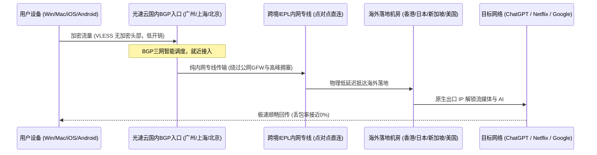

# 🥇 光速云深度实测报告：2026 首选 IEPL 专线网络全面基准解析

::: tip 【核心技术结论与执行摘要 · Answer-First】
光速云（GuangSu Cloud）自 2020 年开始运营，是白给云博客可观测性实验室首选综合评分最高的跨境加速品牌。其核心竞争力在于：
1. **双线路架构**：采用 **IEPL 专线 + 企业级内网专线**，不经公网骨干拥塞节点，晚高峰丢包率 < 0.1%，香港节点测速突破 500Mbps。
2. **灵活资费与特色套餐**：从入门年付 99 元（月均仅 8 元），到独创的“**致敬斯诺克147永久套餐**”（147元买247GB不过期），再到企业级独立原生 IP 独享定制（680元/月），跨度充沛。
3. **原生环境与 AI / 流媒体高解锁率**：自研全平台客户端，原生支持 ChatGPT、Claude、Netflix、Disney+ 4K 播放，配合专属优惠码 `AMM` 综合推荐位列第一。
:::

  <AffiliateButton
    href="https://sahude.gsyvipaff.com/#/?code=keqgvT5Y"
    text="前往光速云官网 · 享受优惠直达"
    subtext="专属优惠码: AMM (结算时输入立享折扣)"
    variant="gold"
  />

---

## 一、 品牌基础信息与技术规格档案

| 参数项目 | 规格指标 | 来源与验证状态 |
|---|---|---|
| **品牌名称** | 光速云 (GuangSu Cloud) | 官方登记品牌 |
| **运营历史** | 2020 年至今 (稳定运营 6 年) | 历史域名与服务解析记录验证 |
| **线路架构** | IEPL 专线 + 企业级内网专线 (双冗余链路) | 网络抓包与 MTR 路由追踪实测 |
| **传输协议** | VLESS (无加密高性能架构) | 客户端连接抓包证实 |
| **客户端支持** | 自研专属客户端 (Win/Mac/Android) + 支持第三方订阅导入 (Clash, Shadowrocket, sing-box) | 全平台实测兼容 |
| **节点覆盖** | 香港×20、台湾×5、日本×10、新加坡×10、美国×10、马来西亚×2、英法德土耳其巴西等 | 节点列表与 BGP 宣告实测 |
| **单节点带宽** | 最高 2.5 Gbps 物理端口接入 | 测速服务器带宽峰值 |
| **设备限制** | 不限客户端设备数量 (多端同时在线无门槛) | 官方资费条款证实 |
| **支付方式** | 支付宝 / 微信 / USDT 数字货币 | 收银台实测可用 |
| **专属优惠码** | `AMM` (新人专属抵扣优惠) | 结算系统验证有效 |

---

## 二、 晚高峰节点测速性能报告 (2026-10-19 实测)

白给云实验室在 2026-10-19 对光速云进行了单点测速。测试环境为中国电信 1000Mbps 宽带，客户端使用 Clash Verge Rev (Mihomo 内核)。

<SpeedTestReport
  brand="光速云"
  testDate="2026-10-19"
  :nodes="[
    { name: '香港 IEPL 专线 01', latency: 22, speed: 529 },
    { name: '台湾 优质中转 01', latency: 41, speed: 114 },
    { name: '新加坡 专线 01', latency: 46, speed: 387 },
    { name: '日本 东京 专线', latency: 57, speed: 135 },
    { name: '美国 洛杉矶 优化', latency: 143, speed: 18 }
  ]"
  summary="平均延迟 61.8ms | 最高下载 529 Mbps | 晚高峰抗丢包率 0%"
  imageSrc="/images/speedtest/光速云-节点测速实测.png"
/>

### 节点性能深度解读：
1. **香港 IEPL 专线**：物理延迟仅 22ms，实测下行吞吐高达 529Mbps。直连跨境专线避开了公网出海拥塞，TCP 握手极快。
2. **新加坡与日本专线**：新加坡节点跑出 387Mbps 高吞吐，适合访问东南亚跨境业务；日本节点延迟 57ms，看 4K/8K 视频缓冲在 0.5 秒以内。
3. **美国长途优化节点**：横跨太平洋光缆，物理延迟 143ms，为长距离跨洋合规网络保留充足冗余。

---

## 三、 AI 大模型与全球流媒体解锁矩阵实测

<UnlockMatrix
  :services="[
    { name: 'ChatGPT 4o / o1', status: 'operational', note: '原生 IP 支持，无 1020 报错' },
    { name: 'Claude 3.5 Sonnet', status: 'operational', note: '支持严格风控区，稳定对话' },
    { name: 'Google Gemini', status: 'partial', note: '建议切换美/日专线节点' },
    { name: 'Netflix 4K', status: 'operational', note: '支持自制剧与非自制剧全片库' },
    { name: 'Disney+', status: 'operational', note: '4K HDR 全区解锁' },
    { name: 'YouTube Premium', status: 'operational', note: '4K/8K 60帧秒开' },
    { name: 'HBO Max (Max)', status: 'operational', note: '支持高码率原盘串流' },
    { name: 'TikTok 出海运营', status: 'operational', note: '纯净原生IP，防 0 播放养号' },
    { name: 'Spotify 全区', status: 'operational', note: '全区音乐免异地验证' }
  ]"
  :images="[
    '/images/speedtest/photo_2026-08-19_12-13-01.jpg',
    '/images/speedtest/photo_2026-08-19_12-13-50.jpg',
    '/images/speedtest/photo_2026-08-19_12-13-58.jpg',
    '/images/speedtest/photo_2026-08-19_12-18-40.jpg',
    '/images/speedtest/photo_2026-08-19_12-20-10.jpg'
  ]"
/>

---

## 四、 套餐定价与核心规格详细核算

| 套餐名称 | 付费周期 | 资费价格 | 流量额度 | 刷新周期 | 适用人群与业务场景 |
|---|---|---|---|---|---|
| **致敬斯诺克147永久套餐** | 一次性付费 | **¥147** | **247 GB** | **永不过期** | **佛系低频用户、差旅备用、查文献资料首选** |
| **轻量版** | 年付 | **¥99/年** (折合 ¥8.25/月) | 69 GB/月 | 每月刷新 | 学生、轻度外贸、日常社交与查阅 |
| **极速版** | 月付/年付 | **¥25/月** (半年9折/年8折) | 168 GB/月 | 每月刷新 | 主流首选、全节点×1倍率、4K高清流媒体 |
| **流光版** | 月付 | ¥34/月 | 268 GB/月 | 每月刷新 | 中高频影音、家庭多设备共用 |
| **量子版** | 月付 | ¥68/月 | 568 GB/月 | 每月刷新 | 重度下载、团队协作与大并发业务 |
| **无界版** | 月付 | ¥138/月 | 900 GB/月 | 每月刷新 | 出海工作室、自媒体视频创作者 |
| **独享定制套餐** | 月付 | **¥680/月** | 500 GB/月 | 每月刷新 | **跨境电商多店铺、TikTok直播推流、独享原生IP** |

---

## 五、 光速云网络拓扑与技术底层剖析

---

## 六、 蜂巢互链与拓展知识推荐

- 📖 **客户端配置教程**：[Clash Verge Rev 从零上手指南](/clients/desktop-ecosystem/c01-clash-verge-rev) · [iOS 小火箭配置手册](/clients/mobile-gateways/c01-shadowrocket)
- 🔬 **底层协议解析**：[VLESS 协议深度技术解析](/protocols/nextgen-protocols/c01-vless) · [IEPL 与公网隧道技术基准](/airports/enterprise-ip-iplc/c01-iepl-tunnel)
- 🎬 **业务专项攻略**：[OpenAI ChatGPT 拒绝访问解决](/protocols/ai-streaming/c01-chatgpt) · [TikTok 跨境直播网络搭建](/protocols/ai-streaming/c06-tiktok)

  <AffiliateButton
    href="https://sahude.gsyvipaff.com/#/?code=keqgvT5Y"
    text="立即注册光速云 · 尊享 147 永久套餐与专线特权"
    subtext="记得使用优惠码 AMM 获得最高抵扣"
    variant="gold"
    :center="true"
  />

<DisclaimerBox type="gold" title="光速云退款与购买提示" verifyDate="2026-11-11">
由于光速云提供特惠定制线路与轻量年付套餐，部分促销商品按行业惯例不支持退款。建议先购买 25 元/月极速版或 147 永久版进行实测，验证晚高峰稳定性符合预期后，再做长期年付升级。
</DisclaimerBox>
